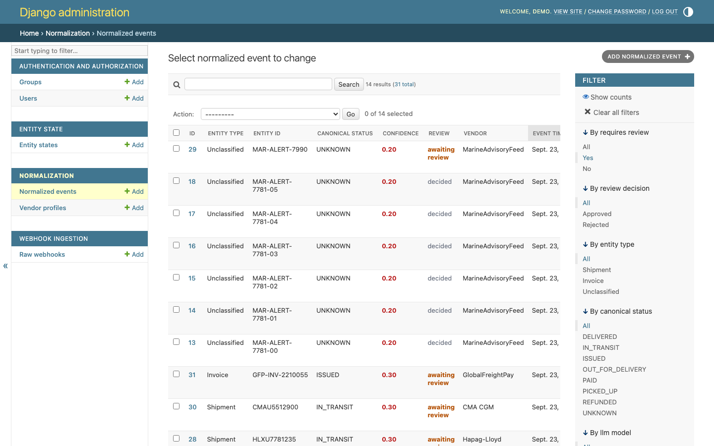
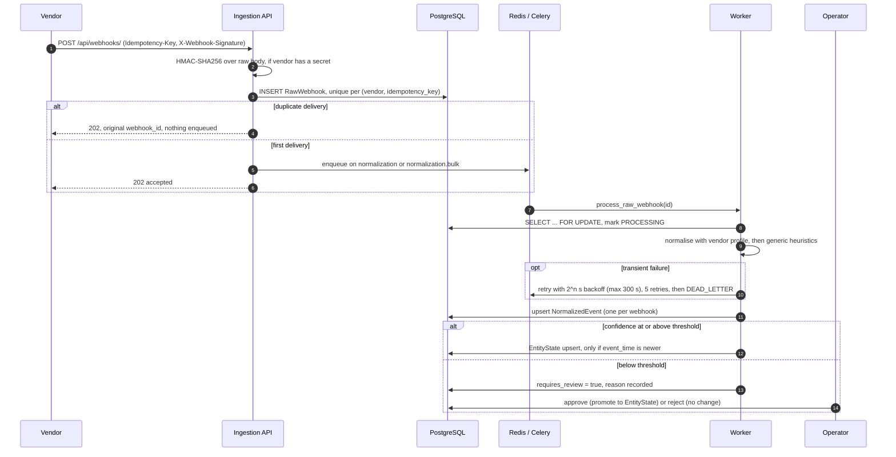
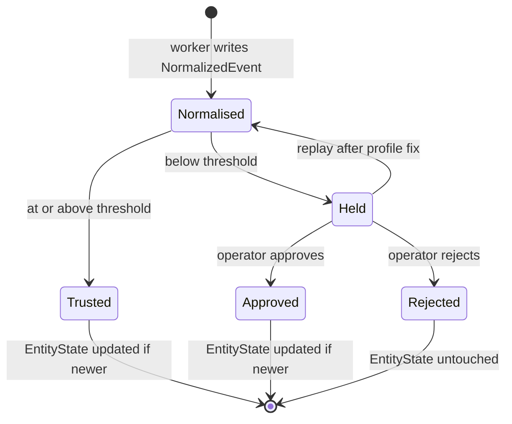
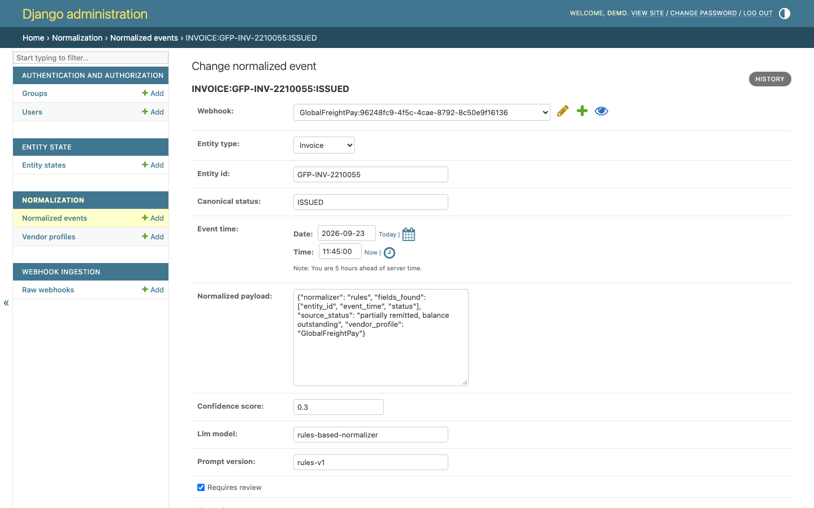
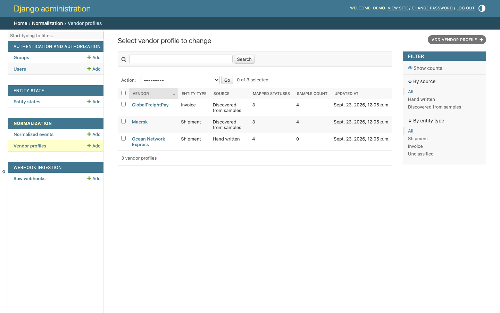

# Inbound Event Gateway

A Django + DRF service that accepts webhooks from carriers and billing vendors, each with its own
payload shape, and reduces them to one canonical status per shipment or invoice. Maersk sends
`{"event_description": "delivered"}`, Ocean Network Express sends
`{"status_text": "Cargo released to consignee"}`, and both end up as a row in `EntityState`.

Every reading carries a confidence score. Anything below `LOW_CONFIDENCE_THRESHOLD` (0.7) is
stored in full but kept out of entity state until a person approves it in the Django admin:



Django 5, DRF, Celery, PostgreSQL 16, Redis 7. With `OPENAI_API_KEY` set an OpenAI model reads
payloads; without one a rule-based normaliser does, and every feature works either way.

## Running locally

```bash
docker compose up --build
```

This starts PostgreSQL, Redis, the web process and two Celery workers (one per queue), runs
migrations, creates a `demo` / `demo-password` admin login and seeds 24 webhooks from four
vendors. Web is on `:8100` (admin at `/admin/`, OpenAPI at `/api/docs/`, liveness at
`/api/health/`), PostgreSQL on `:8101`, Redis on `:8102`. Without Docker, against local services:

```bash
uv sync --extra dev
export POSTGRES_HOST=localhost REDIS_URL=redis://localhost:6379/0 CACHE_URL=redis://localhost:6379/2
python manage.py migrate && python manage.py seed_demo && python manage.py runserver 8100
celery -A config worker --queues normalization,normalization.bulk --loglevel INFO
```

`scripts/send_webhooks.py --count 20` sends synthetic traffic; `.env.example` lists every setting.

## One webhook, end to end

Output from a local run with no API key set (`-H 'Content-Type: application/json'` omitted). A
delivery in a vocabulary the normaliser knows goes straight to entity state:

```console
$ curl -sX POST :8100/api/webhooks/ -H 'X-Webhook-Vendor: Maersk' -H 'Idempotency-Key: MRSK-EVT-2026-000911' \
    -d '{"container_no":"MAEU240498799","event_description":"delivered","event_time":"2026-09-26T10:15:00+00:00"}'
{"status":"accepted","webhook_id":"04178bb0-6b69-4405-af1d-4cf837865707"}
$ curl -s ':8100/api/entities/state/?entity_type=SHIPMENT&entity_id=MAEU240498799'
{"entity_type":"SHIPMENT","entity_id":"MAEU240498799","latest_status":"DELIVERED","latest_event_time":"2026-09-26T10:15:00Z","latest_event_id":25}
```

"Cargo released to consignee" is not in the canonical vocabulary, so the reading scores 0.3, is
held, and the entity has no state yet. The worker logs why, and an operator can rule on it once:

```console
$ curl -sX POST :8100/api/webhooks/ -H 'X-Webhook-Vendor: Ocean Network Express' -d '{"shipment_reference":
    "ONEY9384777","status_text":"Cargo released to consignee","occurred_at":"2026-09-26T09:00:00+09:00"}'
$ curl -sG :8100/api/normalization/review-queue/ --data-urlencode 'vendor=Ocean Network Express'
{"count":2, ... {"id":26,"entity_id":"ONEY9384777","canonical_status":"IN_TRANSIT",
  "confidence_score":0.3,"requires_review":true,"review_reason":"confidence 0.30 is below the 0.70 threshold"}]}
$ curl -s ':8100/api/entities/state/?entity_type=SHIPMENT&entity_id=ONEY9384777'
{"detail":"Not found."}
$ grep normalization_held_for_review worker.log
{"level": "WARNING", "message": "normalization_held_for_review", "event_id": 26, "entity_id": "ONEY9384777", "confidence": 0.3, "threshold": 0.7}
$ curl -sX POST :8100/api/normalization/review-queue/26/ -d '{"decision":"approve"}'
{"id":26,"decision":"approve","entity_state_updated":true}
$ curl -sX POST :8100/api/normalization/review-queue/26/ -d '{"decision":"reject"}'
{"detail":"event 26 was already reviewed at 2026-10-24 11:24:47.188358+00:00"}   # HTTP 409
```

## Architecture



Three Django apps split the tables: `apps/ingestion` owns `RawWebhook` (signatures, idempotency,
routing, replay), `apps/normalization` owns `NormalizedEvent` and `VendorProfile` (backends, the
gate in `review.py`, discovery, calibration), and `apps/entities` owns `EntityState`, one row per
`(entity_type, entity_id)` pointing at the event that set it. A normalised event's lifecycle:




*A held event in the admin: the reading, the fields found and the vendor's original status text.*

## Design decisions

**Hold uncertain readings instead of guessing.** Letting every reading through and fixing it
later means downstream consumers act on a status nobody checked; holding costs operator time and
latency. The worker calls `apply_confidence_gate()`; the review API and the admin's bulk
approve/reject actions both call `apply_review_decision()`, so the paths share one rule. A
decision is final (`409` on a second one) so the audit trail matches what happened.

**Score by the weakest signal.** The rule backend scores entity type,
status and timestamp separately and takes the minimum. An average would let a confidently
recognised container number hide a guessed status. The comparison is strict (`<`), and a test
pins the exact-threshold case so it cannot flip to `<=` unnoticed.

**Teach the vendor rather than review it forever.** `POST /api/normalization/vendor-profiles/discover/`
takes a handful of sample payloads and proposes where the id, status and timestamp live, plus a
status map. It runs statistically with no key; with a key, a model's proposal is merged on top,
but every path it suggests must exist in the samples and every status must be canonical.
Phrases it cannot map are reported, never invented:

```console
{"method":"statistical","sample_count":4,"unmapped_statuses":["cargo_released_to_consignee"],
 "profile":{"vendor":"Ocean Network Express","id_paths":["shipment_reference"],
   "status_map":{"delivered":"DELIVERED","in_transit":"IN_TRANSIT"}},"persisted":true}
```

A person adds the missing word (`PUT /vendor-profiles/{vendor}/` or the admin) and replays the
held webhook from its stored raw payload; it leaves the queue without anyone ruling on it, and
the next "Cargo released to consignee" goes straight to `DELIVERED`. Nothing persists without
`"persist": true`.



**Idempotency from the strongest source available.** The key is the vendor's `Idempotency-Key`
header if sent, then a known event-id field, then a SHA-256 of the canonical payload. Hashing
alone would merge two distinct events that happen to serialise identically, such as two
identical scans of one parcel. Entity state is monotonic in event time, so a late `IN_TRANSIT`
cannot overwrite a `DELIVERED`.

**Bulkhead noisy vendors with an approximate counter.** One queue and one pool would let one
vendor's burst become everyone's latency. Arrivals are counted per vendor in a fixed cache window
(`add` + `incr`, no database write on ingest); past `NOISY_VENDOR_BURST` that vendor goes to
`normalization.bulk`, served by its own worker. Replays always take the bulk lane. The cost is
precision: a burst straddling a window boundary is bulkheaded one window late, and if the cache
is down routing falls back to the default queue.

## Configuration

| Variable | Default | Effect |
|---|---|---|
| `LOW_CONFIDENCE_THRESHOLD` | `0.70` | The gate |
| `NORMALIZATION_BACKEND` | `auto` | `openai`, `rules`, or `auto` (OpenAI if `OPENAI_API_KEY` is set; model `gpt-4.1-mini`) |
| `WEBHOOK_SIGNING_SECRETS` | empty | `vendor=secret,...`; `*` for a shared secret |
| `WEBHOOK_REQUIRE_SIGNATURE` | `False` | Refuse vendors with no configured secret |
| `NOISY_VENDOR_BURST` / `_WINDOW_SECONDS` | `200` / `60` | Bulk-lane routing |
| `CACHE_URL` | in-process | Profile cache and arrival counter; required with more than one process |

## API

| Endpoint | Purpose |
|---|---|
| `POST /api/webhooks/` | Ingest. `202`; `400` for a non-object payload; `401` for a bad signature |
| `POST /api/webhooks/{id}/replay/` | Re-run a stored payload. `409` while in flight unless `{"force": true}` |
| `GET /api/entities/state/?entity_type=&entity_id=` | Current status of one entity |
| `GET /api/normalization/review-queue/` | Held, undecided events. `?vendor=&limit=&offset=` |
| `POST /api/normalization/review-queue/{id}/` | `{"decision": "approve"}` or `"reject"`; `409` if decided |
| `GET /api/normalization/low-confidence/` | All events under a threshold, whatever the gate did |
| `GET /api/normalization/calibration/` | Per-vendor approval rates against the threshold |
| `GET/PUT/DELETE /api/normalization/vendor-profiles/{vendor}/` | Vendor profile CRUD (list at `/vendor-profiles/`) |
| `POST /api/normalization/vendor-profiles/discover/` | Propose a profile from samples |

`manage.py calibration_report` prints the calibration table. It can show the threshold is too
high (approvals piling up below it) but cannot show it is too low: events above it are never reviewed.

## Testing

```bash
POSTGRES_HOST=localhost python -m pytest -q   # 270 passed
ruff check . && ruff format --check .
```

It needs a real PostgreSQL (`SELECT ... FOR UPDATE`, a partial index) and makes no network calls:
the OpenAI client is mocked and an autouse fixture clears `OPENAI_API_KEY`. Tests focus on the gate
boundary, the retry ladder ending in `DEAD_LETTER`, redelivery by header, event id and hash, forged
signatures, out-of-order events, routing, discovery and calibration.

## Limitations and next steps

- **Authentication.** Only ingest is protected (by signature); review, replay, profile and entity endpoints are open.
- **Signature freshness.** Signatures do not bind a timestamp, so a captured, never-delivered body stays valid.
- **Calibrated scores.** Confidence separates approvals from rejections but is not a probability.
- **Per-type thresholds.** One threshold covers every vendor and entity type; invoices probably deserve a higher bar.
- **Fair scheduling.** The bulk lane is a bulkhead only, and without `CACHE_URL` each gunicorn worker counts separately.
- **Dead-letter triage.** Dead-lettered webhooks are replayable one at a time; there is no bulk requeue.
